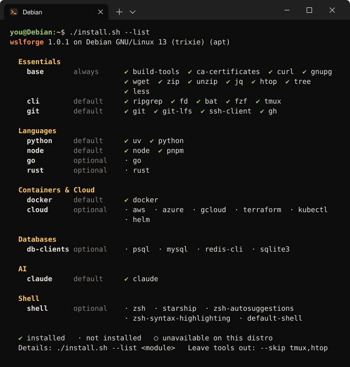
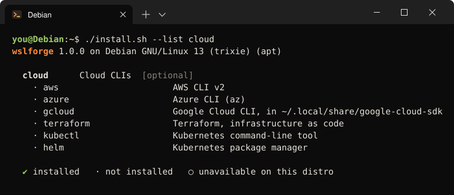

<p align="center"></p>
<h1 align="center">wslforge</h1>
<p align="center">Your WSL development environment, forged in one command.</p>

<p align="center"></p>

## Forge your setup

wslforge asks a few questions, and every one has a default. Then it gets the rest done: the distro, your Linux user, the WSL limits, and your tools. You get git and the GitHub CLI, Python, Node.js, Docker, Claude Code and more.

Run it again whenever you like. It only installs what is missing and leaves the rest alone.

## Install

Pick the line that matches your PC:

| You have | Run | wslforge |
| --- | --- | --- |
| **No WSL yet** | the PowerShell command | turns on WSL, then creates a new distro and sets it up |
| **WSL, and you want a fresh distro** | the PowerShell command | creates a new distro next to your others, which stay untouched |
| **A distro you already use** | the Linux command, inside it | installs the tools in that distro |
| **Linux, without Windows** | the Linux command | installs the tools on your laptop, VM or server |

### A new distro, from Windows

Open PowerShell (no administrator needed) and run:

```powershell
irm https://raw.githubusercontent.com/PLeonLopes/wslforge/v1.0.1/install.ps1 | iex
```

1. **Answer the questions.** The questions cover:
   - the distro, with its name and install folder;
   - your Linux user;
   - how much memory and how many CPU cores WSL may use;
   - what to install;
   - your git name and email.

   Press Enter to keep a default. If you already have an `Ubuntu`, the new one is suggested as `Ubuntu-2`, so nothing gets overwritten.
2. **Approve the prompts.** Windows asks for administrator rights only if WSL must be turned on or updated. If a restart is needed, wslforge continues by itself after you sign in again. With an up-to-date WSL, none of this happens.
3. **Choose a password** for your Linux user. wslforge creates the distro and installs everything inside it. To open it afterwards, run `wsl -d <name>` or pick it from the Windows Terminal menu.

### A distro you already have, or plain Linux

Open your distro (Ubuntu, Debian, Fedora...) and run:

```bash
curl -fsSL https://raw.githubusercontent.com/PLeonLopes/wslforge/v1.0.1/install.sh | bash
```

A menu lets you pick a profile or single tools. It asks for your `sudo` password only when something needs it.

The same command works on a regular Linux install, not only in WSL. On a laptop, a VM or a server running a [supported distro](#supported-distros), the WSL-only steps are skipped. For example, Docker then starts through your system's own systemd.

## What you get

**Installed by default.** These come with the recommended `dev` profile:

| For | You get |
| --- | --- |
| Everyday basics | compilers and build tools, curl, wget, zip, jq, htop, tree |
| A faster terminal | ripgrep (search), fd (find files), bat (view files), fzf (fuzzy finder), tmux |
| Git and GitHub | git, git-lfs, SSH, the GitHub CLI (`gh`), and your git name and email |
| Python | uv, plus a recent Python managed by it |
| JavaScript | Node.js LTS (through fnm) and pnpm |
| Containers | Docker with Compose, right inside WSL, so you don't need Docker Desktop |
| AI coding | Claude Code |

**Optional extras.** These are never installed unless you ask. Pick them in the menu, or add one by name, for example `--only cloud`:

| Name | For | You get |
| --- | --- | --- |
| `go` | Go | the latest Go |
| `rust` | Rust | rustup and the stable toolchain |
| `cloud` | Cloud and Kubernetes | AWS, Azure and Google Cloud CLIs, Terraform, kubectl, Helm |
| `db-clients` | Databases | psql, mysql, redis-cli and sqlite3 (clients only, no servers) |
| `shell` | A nicer shell | zsh with the starship prompt, autosuggestions and syntax highlighting |

Tools come from each project's official source: your distro's packages, the vendor's own repository, or a release download checked against its SHA-256.

## Pick what you need

| Profile | Installs |
| --- | --- |
| `minimal` | just the everyday basics and Git |
| `dev` | everything under *Installed by default* (the default) |
| `full` | everything, optional extras included |

From a clone, or with `bash -s --` after the `curl` command above:

```bash
./install.sh                          # interactive menu
./install.sh --list                   # every module and tool, and what is installed
./install.sh --list cloud             # one module, with descriptions
./install.sh --profile full -y        # everything, no questions
./install.sh --only go,rust           # just these modules
./install.sh --skip tmux,docker       # the default modules, minus a tool and a module
./install.sh --dry-run                # show what would happen, change nothing
```

To repeat a setup, save it in a [`wslforge.conf`](examples/wslforge.conf) file (`PROFILE`, `MODULES`, `SKIP`, `GIT_NAME`, `GIT_EMAIL`) and run `./install.sh --config wslforge.conf`. The file is only read, never executed. `./install.sh --help` lists every option.

<p align="center"></p>

## Supported distros

| Family | Distros | Tested in CI |
| --- | --- | --- |
| apt | Ubuntu, Debian, Kali | Ubuntu 24.04, Debian 13 |
| dnf | Fedora, AlmaLinux | Fedora (latest), AlmaLinux 9 |
| pacman | Arch Linux | Arch (latest) |

Ubuntu and Debian get the most testing. Fedora, AlmaLinux and Arch are covered by CI too, but they move faster, so if something breaks on your distro, please [open an issue](https://github.com/PLeonLopes/wslforge/issues).

**Requirements:** Windows 11, or Windows 10 version 22H2, with Windows PowerShell 5.1 (built in). wslforge updates WSL to 2.4.4 or newer if needed. Inside Linux, it needs `bash`, `curl` and `tar`.

<details>
<summary>What changes on my system?</summary>

- **Windows:** WSL is enabled if it was off, and the new distro goes in the folder you chose. `~\.wslconfig` gets the memory and CPU limits; a copy of the old file is kept as `~\.wslconfig.wslforge-backup`. Your answers are saved in `~\.wslforge\wslforge.conf`.
- **Linux:** packages come from your distro and from official vendor repositories (GitHub CLI, Docker, Azure CLI). User tools go to `~/.local`. Each run is logged to `~/.wslforge/install.log`.
- **Shell:** optional modules add their tools to PATH through `~/.wslforge/env.sh`. A block marked `# >>> wslforge >>>` in `~/.bashrc` (and in `~/.zshrc` for zsh) loads it. To undo, delete that block and the file.

</details>

<details>
<summary>Running it again, and adding tools later</summary>

Running wslforge again is safe: tools already installed are skipped, and the summary shows what changed. To add a module later, run `./install.sh --only <module>`, for example `--only cloud` (or `curl ... | bash -s -- --only cloud`).

</details>

<details>
<summary>Something went wrong</summary>

- The summary at the end lists each tool as installed, already there, skipped or failed. A failed tool never stops the others.
- The full output is in `~/.wslforge/install.log`. Run the installer again after fixing the cause; only what is missing is retried.
- On Windows, your answers are kept. To retry without answering again (finished steps are skipped):

  ```powershell
  & ([scriptblock]::Create((irm https://raw.githubusercontent.com/PLeonLopes/wslforge/v1.0.1/install.ps1))) -Resume
  ```

</details>

[Changelog](CHANGELOG.md) · [Contributing](CONTRIBUTING.md) · [Report an issue](https://github.com/PLeonLopes/wslforge/issues) · [MIT License](LICENSE)
